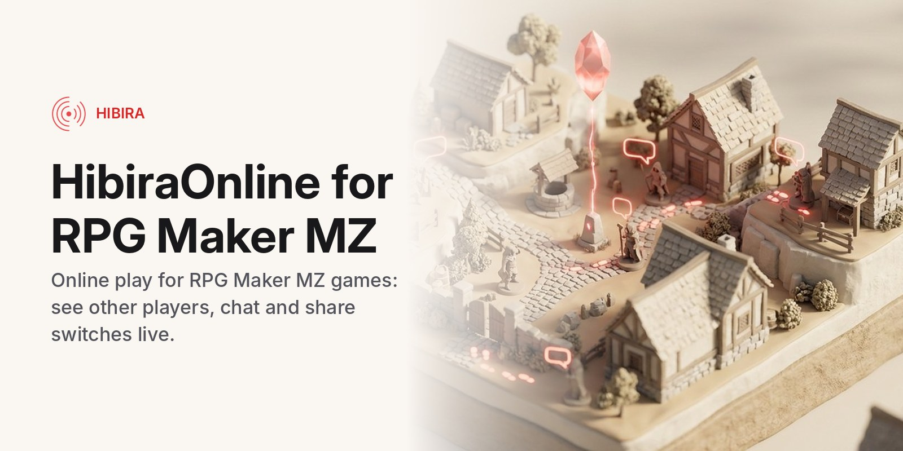

# HibiraOnline.js for RPG Maker MZ



[](https://github.com/hibira-io/rpgmaker-mz/actions/workflows/ci.yml)

[日本語](#日本語) · English

Online play for RPG Maker MZ games on
[Hibira](https://hibira.io/?utm_source=github&utm_medium=readme&utm_campaign=plugins),
a hosted realtime service that speaks the Pusher Channels protocol. Players
in the same room:

- **see each other** walk around the map, with their character graphics and names,
- **chat**, in a small window at the bottom of the map,
- **share switches and variables** you choose (a door one player opens is open for everyone; players who join later get the current values),
- **send your own events** to each other ("boss", "trade", ...), each with a value, which can run a common event.

There is no game server to run. The only server part is a small auth
endpoint that signs room subscriptions with your app secret; a Cloudflare
Worker for it (free plan) is in [`server/`](server).

It works in playtests, Windows and macOS builds (NW.js) and web builds.
The plugin and editor texts come in English, 日本語, 中文 and 한국어.

## Set up

1. Create a free app at [hibira.io](https://hibira.io/portal) (no card).
   In its settings, turn on **Allow client events**.
2. Deploy the auth endpoint:

   ```sh
   cd server
   # put your app key in wrangler.toml, then:
   npx wrangler deploy
   npx wrangler secret put HIBIRA_APP_SECRET
   ```

   Any endpoint that signs pusher-js presence subscriptions works instead,
   as long as it allows channels starting with `presence-mz-`.
3. Download [`HibiraOnline.js`](https://github.com/hibira-io/rpgmaker-mz/releases/latest)
   into your project's `js/plugins/` and turn it on in the Plugin Manager.
   Set **App key** (the key, never the secret) and **Auth endpoint** (your
   Worker's URL).
4. In an event, run the plugin command **Join room** with a room name.
   Players who join the same name meet.

## Parameters

| Parameter | |
|---|---|
| App key, Host, Port, TLS | your Hibira app; `ws.hibira.io`, 443, on |
| Auth endpoint | the URL that signs room subscriptions |
| Room channel prefix | `presence-mz-`; rooms are presence channels named prefix + room name |
| Player name variable | the variable with the name others see; 0 uses the party leader's name |
| Show other players, opacity, show names | other players in the same room and map |
| Shared switches, shared variables | lists of IDs kept the same for everyone in the room |
| Connected switch, players variable | ON while in a room; number of players, you included |
| Chat window, lines, seconds | the chat at the bottom of the map |

## Plugin commands

| Command | |
|---|---|
| Join room | room name, or a variable holding it |
| Leave room | |
| Send chat | text, or a variable holding it |
| Send event | event name, and a variable whose value goes with it |
| On event | when another player sends this event: store its value and the sender's name in variables, run a common event. Run it once, for example from an autorun event at the start |

Script calls: `HibiraOnline.join('town')`, `HibiraOnline.leave()`,
`HibiraOnline.say('hi')`, `HibiraOnline.sendEvent('boss', 3)`,
`HibiraOnline.members` (a Map of the other players).

## How much it costs

Each move, chat line, switch or variable change and custom event is one
message on your Hibira plan; each player sends at most 8 a second, and only
when something changed. Each running game is one connection. The free plan
has 100 connections and 200,000 messages a day, plenty for testing and a
small game. A room holds up to 100 players.

## Limits

Clients are trusted: a player could change what their game sends. Use it
for co-op, social and casual play, not for competitive games where cheating
matters. Events and other players' NPC moves are not synced, only the
player characters, the shared switches and variables, chat and your own
events.

## Develop

```sh
npm test           # builds dist/HibiraOnline.js and runs the tests on a stub of MZ
# Two games in Chromium against a real server (needs Playwright):
HIBIRA_E2E_KEY=... HIBIRA_E2E_SECRET=... HIBIRA_E2E_HOST=ws.hibira.io node test/e2e.mjs
```

`src/header.js` is the plugin header (parameters and commands in four
languages), `src/HibiraOnline.body.js` the plugin. `dist/HibiraOnline.js`
is built from them with pusher-js 8.6.0 included, and committed.

## License

[MIT](LICENSE). It includes [pusher-js](https://github.com/pusher/pusher-js)
(MIT, `vendor/pusher-js-LICENSE.txt`). You can use it in free and
commercial games.

---

## 日本語

RPG Maker MZ のゲームに、[Hibira](https://hibira.io/?utm_source=github&utm_medium=readme&utm_campaign=plugins)
（Pusher Channels 互換のホスト型リアルタイムサービス）でオンライン機能を
追加するプラグインです。同じルームのプレイヤー同士で：

- マップを歩く**他のプレイヤーが見えます**（歩行グラフィックと名前つき）
- マップ下部の小さなウィンドウで**チャット**できます
- 指定した**スイッチと変数を共有**します（あとから入ったプレイヤーにも今の値が届きます）
- **独自のイベント**（「boss」「trade」など）を値つきで送り合い、コモンイベントを実行できます

ゲームサーバーは不要です。必要なのは、アプリの secret でルームの購読に
署名する小さな認証エンドポイントだけで、Cloudflare Worker（無料プラン）
版を [`server/`](server) に用意しています。テストプレイ、Windows・macOS
（NW.js）、Web 出力で動きます。

### 設定

1. [hibira.io](https://hibira.io/portal) で無料のアプリを作り（カード不要）、
   設定で **クライアントイベントを許可** をオンにします。
2. 認証エンドポイントをデプロイします（`server/` で `npx wrangler deploy`、
   続けて `npx wrangler secret put HIBIRA_APP_SECRET`）。
3. [`HibiraOnline.js`](https://github.com/hibira-io/rpgmaker-mz/releases/latest)
   をプロジェクトの `js/plugins/` に入れ、プラグイン管理でオンにします。
   **App key**（secret ではなく key）と **認証エンドポイント**（Worker の
   URL）を設定します。
4. イベントからプラグインコマンド **ルームに参加** をルーム名つきで実行します。

料金の目安：移動・チャット・スイッチや変数の変更・独自イベントはそれぞれ
1 メッセージで、1 プレイヤーあたり毎秒 8 件までです。無料プランは同時接続
100、1 日 20 万メッセージです。

クライアントを信頼する仕組みなので、協力プレイや交流向けです。不正が問題に
なる対戦ゲームには向きません。

ライセンスは [MIT](LICENSE) です。無料・商用どちらのゲームにも使えます。
